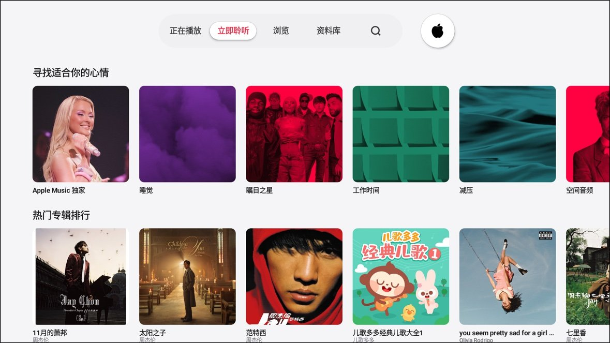
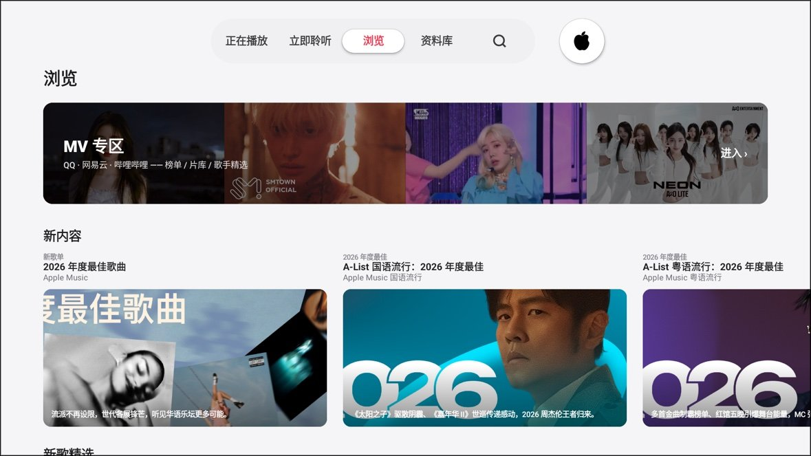
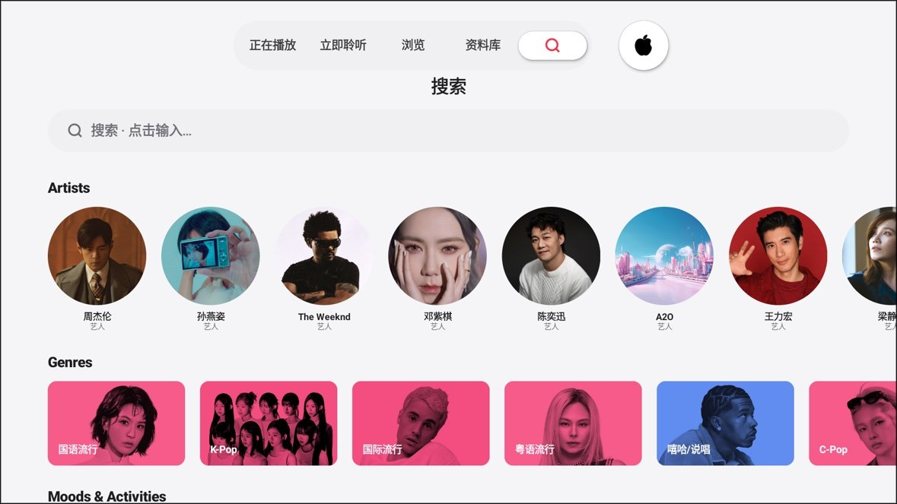
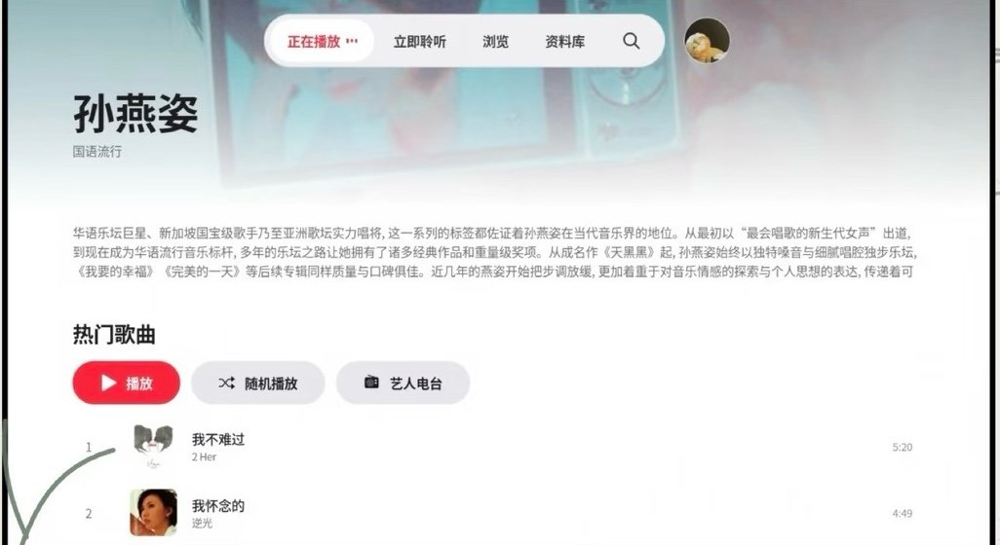
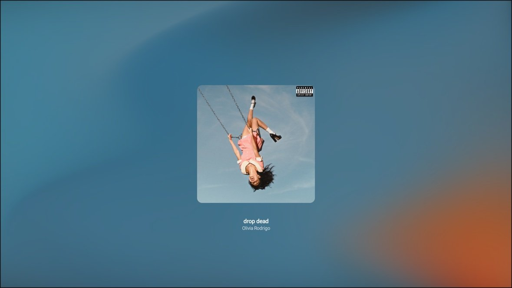
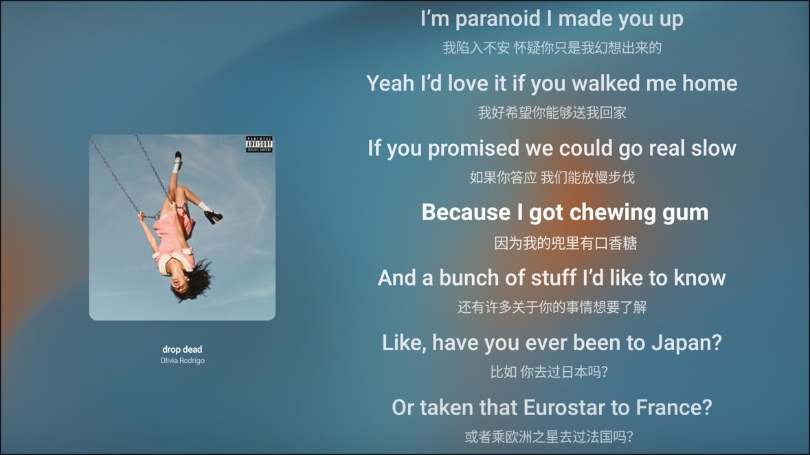
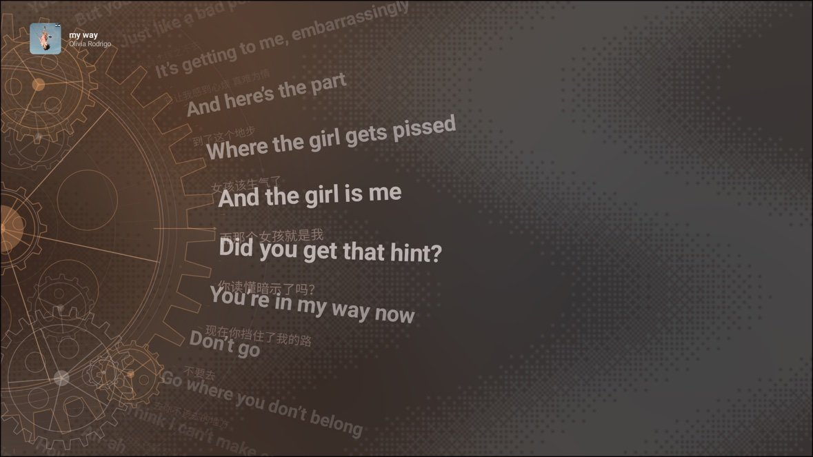
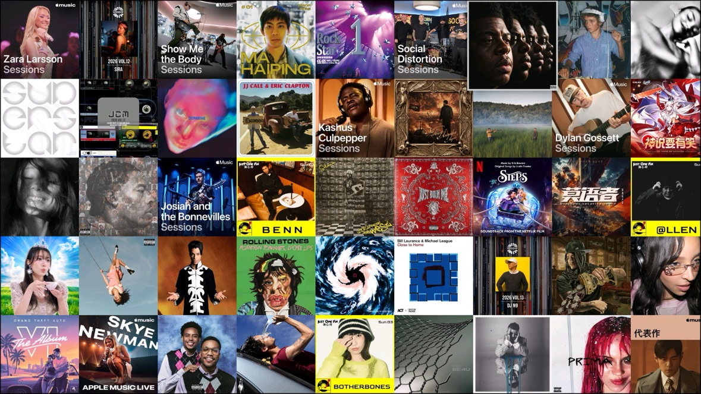

# AMTV

**电视上的 Apple Music 风格音乐播放器** —— 为安卓电视 / 投影仪打造的大屏音乐应用。

作者：夏恩

AMTV 把 Apple Music 式的界面搬到电视上：立即聆听、浏览、资料库、艺人页与全屏歌词舞台一应俱全。展示内容（歌单、榜单、推荐、官方歌词）来自苹果音乐目录，实际播放的音频走可自由配置的落雪（LX）音源——不用订阅，也能在大屏上好好听歌。

## 关于本项目（致谢）

**本项目是基于 Lavande 的作品 Apple Music TV 的二次创作。** AMTV 的界面设计与交互源自 Lavande 的原创作品 [Apple Music For Android TV](https://github.com/lavande16/Apple-Music-For-Android-TV)（官网：[applemusictv.pages.dev](https://applemusictv.pages.dev)），本人在其基础上更换了音频来源（落雪音源）、做了本地化调整与后续维护。感谢 Lavande 的开放与分享——没有原作，就没有这个项目。

本项目与 Apple Inc. 无任何隶属、合作或授权关系；Apple Music 及相关商标归 Apple Inc. 所有。

## 亮点

- **流体封面背景**：正在播放的背景随专辑封面取色、全屏流动，换歌自动换色。
- **全屏歌词与多档视觉舞台**：全屏封面舞台（左封面、右双语歌词列、当前行逐字高亮扫过）、黑胶唱片舞台等多种播放画面，播放中随时切换。
- **完整的艺人页与专辑页**：艺人横幅大图、热门歌曲、最新发行、艺人介绍，专辑页曲目列表一键全播 / 随机播放。
- **手机配置网页**：在电视端设置里开启「连接」后扫码，改设置、导入歌单、换音源、看日志都能在手机上办；页面链接带一次性令牌，用完即废，不怕被蹭。
- **扫码小工具**：粘贴令牌、导入歌单、导入音源、上传动态图背景（GIF / 动态 WebP 作自定义背景），全都可以扫码在手机上完成，不用拿遥控器戳长串字符。
- **为遥控器打磨的操作感**：每一行都记得你上次停的卡片；任意页面长按 ↓ 约 1 秒直达正在播放；播放页控制栏任意按键唤出、停手自动隐没；退回桌面自动存档，下次打开按播放就从存档处续上。
- **该有的设置都在**：后台播放、歌词偏移、交叉渐变、音量均衡、全屏歌词开关等，按自己的设备和口味调。

## 截图

▲ 首页「立即聆听」

▲ 浏览

▲ 搜索

▲ 艺人页

▲ 正在播放 · 流体封面背景

▲ 全屏封面舞台 · 双语歌词

▲ 视觉舞台 · 齿轮

▲ 唱片墙 · 整墙封面

## 安装教程

### 1. 下载

到本仓库的 [Releases](../../releases) 页面下载最新版 APK 安装包。

### 2. 装到电视上

任选一种顺手的方式：

- **U盘**：把 APK 拷进 U 盘，插到电视 / 投影仪上，用系统文件管理器打开安装；
- **手机传包**：手机和电视连同一个 Wi-Fi，用电视助手类工具把 APK 推送到电视上安装；
- **adb**（进阶）：`adb install AMTV.apk`。

如果系统拦截，先在电视的系统设置里允许「安装未知来源应用」再重试。

> 系统要求：安卓电视 / 投影仪（在 Android 9 设备上长期实测使用）。

### 3. 首次打开，先做两件设置

按遥控器进入**设置**页（顶栏右侧圆形图标）：

**① 确认音源（必须）**
音频由落雪（LX）音源提供。在设置的音源一节里，可以扫码从手机导入音源脚本、粘贴音源链接导入，或选用列表里已有的音源；排在前面的音源优先使用。

**② 登录苹果音乐（可选，但推荐）**
在「设置 → 苹果音乐」点登录，电视会显示二维码；用手机扫码打开页面，把你的 **Music User Token** 粘贴进去即可。

- 令牌只用来拉取苹果的歌单、推荐与官方歌词，**不需要订阅**；不登录也能用公开榜单和搜索。
- 令牌只保存在电视本机，不经过任何第三方服务器。
- 令牌获取方法（不用电脑，手机就能办）：配置页里有「怎么拿到这个令牌？」分步教程——用手机浏览器打开 [music.apple.com](https://music.apple.com) 登录 Apple 账号，把教程里给的「令牌指令」存成书签，回到 Apple Music 页面点一下书签，令牌就会弹出并自动复制，再回配置页粘贴登录即可。

**③ （可选）开启手机配置网页**
在设置的「连接」一节打开手机配置网页开关，之后改设置、导歌单、换音源都可以扫码在手机上完成。

## 使用说明（遥控器）

- **方向键**移动焦点，**OK** 播放 / 确认，**返回键**回上一层。页面会记住每一行你上次停的卡片，回来还落在原处。
- **切换视觉舞台**：播放中按遥控器的 **MENU（菜单）键** 打开特效选档，换封面舞台、黑胶唱片等播放画面（不同品牌遥控器键名略有差异，以菜单 / 列表键为准）。
- **长按 ↓ 约 1 秒**：不管在哪个页面，直接跳到「正在播放」；按返回又回到刚才的页面。
- **控制栏**：播放页按任意键唤出，停手几秒自动隐没；暂停时常显。
- **退出不丢进度**：退回桌面后播放进度自动存档，下次打开按播放即续播。

## 常见问题

**Q：安装时提示失败 / 签名冲突？**
多半是电视上装过同包名的其他版本。先把旧版卸载再装新版；注意卸载会一并清掉本机保存的令牌和设置，装好后需要重新配置一次。另外请只从本仓库 Releases 下载：安装包带签名自校验，被改包 / 重签的包将无法运行。

**Q：打开后歌单是空的、没内容？**
先确认电视联网正常；再到设置里看音源是否已启用。苹果的个性化推荐需要先完成上面的令牌登录，未登录时只有公开榜单和搜索可用。

**Q：歌能搜到但播不了 / 没有声音？**
音频走音源，和展示目录是两条线。换一首试试，或到设置里调整音源顺序、换一个音源再播。

**Q：歌词和声音对不上，慢半拍？**
到设置里调「歌词偏移」，往前 / 往后拨到对齐为止。

**Q：遥控器上没有 MENU 键，怎么换舞台？**
找遥控器上的「菜单 / 列表」键，一般就是它；也可以先在播放页唤出控制栏，从控制栏进入特效选择。

## 下载

最新版安装包在 [Releases](../../releases)，下载 APK 后按上面的教程安装即可。

## 声明

个人学习作品，免费分享，仅供学习交流使用。

请勿对安装包进行二次打包、改包或冒充原作者发布——安装包已加入签名自校验，改动后将无法运行。音乐内容版权归各权利方所有。
